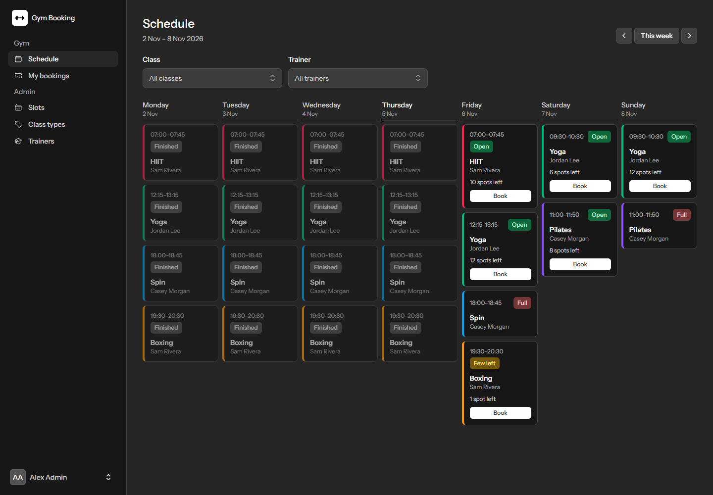
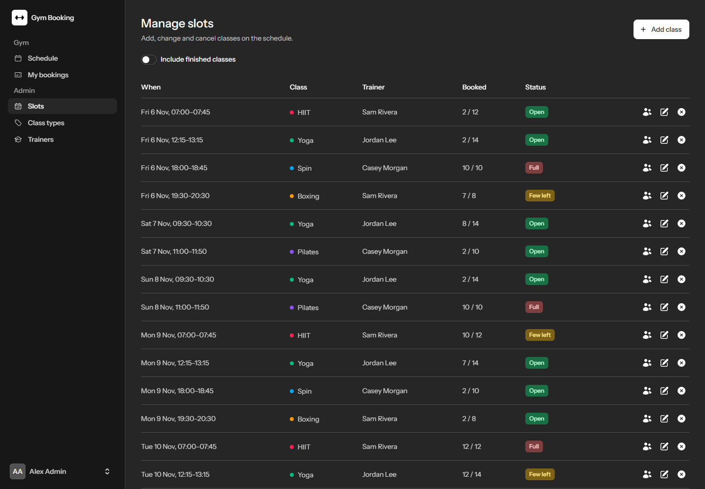
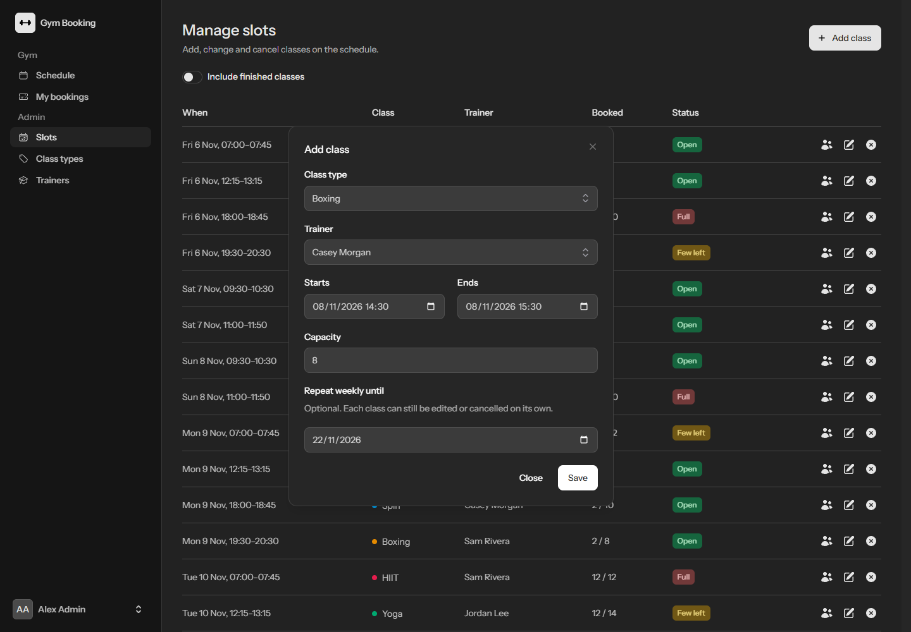
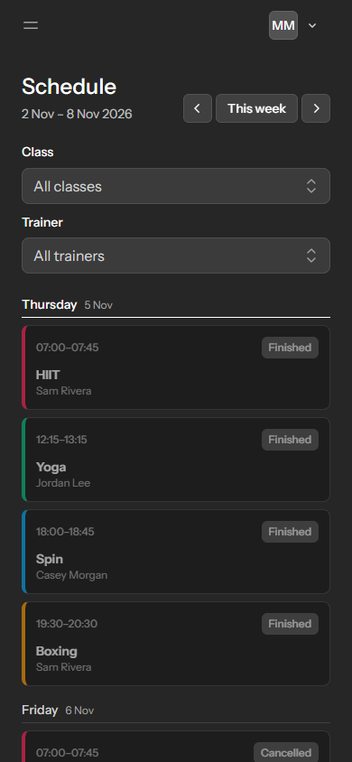

# Gym Booking

[](https://github.com/emroli/gym-booking/actions/workflows/tests.yml)

Members book gym classes, every class has a capacity limit, and admins manage the schedule. When someone books or cancels, the spot count updates in everyone else's browser without a refresh.

Built with Laravel 13, Livewire 4, Reverb, Flux, Tailwind CSS and Pest, on PHP 8.4.



| Admin schedule | Adding a repeating class | On a phone |
|---|---|---|
|  |  |  |

## Features

**Members**
- Browse a week calendar without logging in, and filter by class or trainer
- Book and cancel from the calendar, with live spot counts
- See upcoming bookings and history on My Bookings

**Admins**
- Add a single class, or repeat one weekly until a chosen date
- Edit or cancel any class in a series on its own
- See who's attending, and cancel a member's booking
- Manage class types and trainers

**Booking rules**
- No overbooking: a class can't exceed its capacity
- No double booking: a member can't book the same class twice, or two classes that overlap (back-to-back is fine)
- Classes can be booked up to 14 days ahead, and never after they start
- Members can cancel up to 2 hours before a class

The two time limits are set in `config/booking.php`, and can be overridden from `.env`.

## Getting started

You'll need PHP 8.4.1 or newer, Composer, and Node.js 22 or newer.

```bash
git clone https://github.com/emroli/gym-booking.git
cd gym-booking
composer setup
php artisan db:seed
composer dev
```

Then open http://localhost:8000. `composer dev` runs the web server, queue worker, Reverb and Vite together.

| Demo login | Email | Password |
|---|---|---|
| Admin | `admin@example.com` | `password` |
| Member | `member@example.com` | `password` |

To see live updates, log in as different users in two separate browsers, then book a class in one and watch the other. These demo accounts are for local use only, and the seeder refuses to run in production.

Set `APP_TIMEZONE` in `.env` to your gym's timezone. Class times are shown and repeated in it.

## How it works

### Data model

```
users ─┬─< bookings >── slots >── class_types
       │                    └──> trainers
       └─ role (Member or Admin)
```

`Booking` is a pivot model with its own ID and a `cancelled_at` column. A unique index allows one row per member and class, so rebooking after a cancellation reactivates the existing row and keeps the history. Spots left are always counted from active bookings, so the number can't drift out of sync.

### Preventing overbooking

Two people going for the last spot at the same moment is the hard case. [`BookSlot`](app/Actions/BookSlot.php) runs every check and the insert inside one write transaction:

- **SQLite** has no row locks, so transactions use `IMMEDIATE` mode, which takes the write lock at the start. Writers run one at a time, with a busy timeout so they wait rather than fail.
- **`lockForUpdate()`** stays in the code. SQLite ignores it, but other databases need it.
- **The unique index** is the final guard against a duplicate booking, and a violation becomes the normal "already booked" message.

This was tested with real parallel PHP processes against a file-based database, because an in-memory test can't show it:

| Scenario | Result |
|---|---|
| 10 processes, 1 spot left (3 runs) | 1 booked, 9 told the class is full, every run |
| 12 processes, 3 spots left | 3 booked, 9 told the class is full |
| 1 member in 10 tabs, 10 spots left | 1 booked, 9 told they've already booked |
| Control: `DEFERRED` mode, 10 processes, 1 spot left (2 runs) | 1 booked, 9 crashed with "database is locked" |

The control shows what the setting is for. Without it, SQLite still didn't overbook in these runs, but the losing requests failed with server errors instead of a clear message.

### Live availability

After a change commits, [`SlotAvailabilityChanged`](app/Events/SlotAvailabilityChanged.php) goes out over Reverb on a public channel. It carries only the slot ID, never member data. Open calendars then re-read from the database, so the server stays the source of truth.

If Reverb is down, the failed broadcast is logged and the booking still succeeds. The page just stops updating live.

### Authorization and validation

These are kept separate:

- **Policies** decide who may act. [`BookingPolicy`](app/Policies/BookingPolicy.php) lets an owner cancel before the cutoff and an admin at any time, and returns the reason when it says no.
- **Actions and form objects** decide whether a change is valid. For example, capacity can't drop below the booking count, a booked class can't be moved, and a trainer can't teach two overlapping classes.

Livewire actions are their own HTTP endpoints, so each one checks authorization itself rather than relying on the page's route. The tests confirm this by opening a page as an admin and calling its actions as a member.

`role` isn't mass assignable, so a registration or profile form can't be used to become an admin.

## Testing

```bash
composer test
```

This runs Pint, PHPStan at level 7 and the Pest suite, which covers the booking rules and their exact time boundaries, policies, every Livewire page, broadcasting and architecture conventions. GitHub Actions runs the same checks on every push.

## Known limitations

- Single gym and timezone
- No waitlist, email notifications or payments
- Members aren't notified when an admin cancels a class, but they see it on My Bookings and the calendar
- Booking doesn't require a verified email, because the demo's mail driver only writes to the log
- There's no screen for granting admin access. Use `php artisan tinker`, or the seeded admin account
